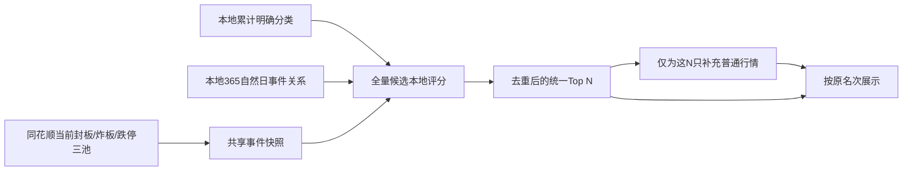

# 今日涨停核心：低在线请求评分与行情主备设计

日期：2026-11-12，上海时区。

状态：公式、低在线请求链路与行情主备已接入代码并通过本地测试；尚未完成本轮生产发布验收。同行评审覆盖了现有公式、实际请求链与多源字段契约。本文中的参数是可回放验证的初始规则，不是已回测有效的收益权重。同花顺备用行情限定为Web端实际调用的API，不采用iFinD正式数据服务。

## 1. 排名回答的问题

根据当前已封板股票，判断哪些方向正在形成，并把与这些方向有明确题材归属、历史专属联动的未封板股票排成一个结果集。

名次由“当日三池事件 + 本地历史”决定。当前涨幅、换手、量比、普通主力资金和暗盘资金退出排名。普通行情只给最终结果补展示字段；补到、补不到、改用备用供应商，都不改变分数和顺序。用户按展示行情人工确认盘中机会。

## 2. 数据窗口与归属

| 数据 | 用途 | 窗口 |
| --- | --- | --- |
| 同花顺涨停简图明确分类 | 股票多标签归属、题材倒排索引 | 截至前一完整分类归档日的全部已存累计数据；不因365日窗口移出而删除标签 |
| 涨停、炸板、跌停历史事件 | 共封关系、股性与证据日期 | 默认365自然日；分母只含完整归档交易日，缺日不补零 |
| 分类日成员记录 | 核实两股是否同日以相同题材共封 | 与历史关系同一窗口；缺分类记录不视为不同题材 |
| 东财行业/概念关系 | 没有任何有效同花顺标签时的本地兜底 | 使用已有有效关系截面；不在打开今日核心时同步 |
| 20交易日普通日行情 | 流动性、上市/风险背景展示 | 本地盘后数据；不进入本版评分 |
| 5分钟行情和资金 | 既有历史研究、后续分钟回放 | 本版评分不使用，也不读取同分钟历史分位 |
| 当日实时三池 | 当前方向、回封时效、炸板/跌停惩罚、候选资格 | 一份日期+scope共享快照 |

现有代码的20交易日是盘中指标的自身历史分位窗口；365自然日用于事件关系，且当前标签读取也被同一起日截断。新版需要把累计标签索引与365日关系窗口解耦。

分类继续来自 `tab_list + all_tab_data`。`block_top`不参与题材聚类。“其他概念”“未分类”“原因不明”和不可用原因桶不构成聚类。某标签历史出现一次足以确认曾经归属，但一条强历史联动边必须同题材共同封板至少两次。

明确同花顺标签优先。完全缺少有效标签的股票才查本地东财关系；跨命名体系仅接受版本化的明确映射，不能凭模糊名称相似强行合并。映射未确认的东财分类保留独立身份和来源。不同来源不默认乘固定折扣；不确定性按映射和覆盖证据显示。

## 3. 每条当日方向的强度

对方向 `t` 定义：

- `S_t`：当前仍封板、归到此方向的不同股票集合；`n=|S_t|`，至少2只。
- `b`：此方向当前炸板数，排除已在跌停池的股票。
- `d`：此方向当前跌停数；同股炸板后跌停只按跌停罚一次。
- `U`：本地同scope、同截面可识别分类的股票全集规模，与候选Top N无关。
- `m`：上述全集中归到此方向的股票数。
- `S`：当前全市场封板股票中处于上述可识别全集的股票数，不是此方向的封板数；各方向使用同一快照与scope。
- `e = S × m/U`：按标签覆盖比例自然应有的封板数。
- `Δt`：此方向当前封板成员最近一次封板/回封到快照的交易分钟，排除午休和闭市。

四项相乘：

\[
M_t = \underbrace{\frac{n}{n+3}}_{封板规模可信度}
      \times \underbrace{\max\left(0,\frac{n-e}{n+e}\right)}_{超额封板集中度}
      \times \underbrace{\frac{n}{n+0.5b+d}}_{封板质量}
      \times \underbrace{\left[e^{-\Delta t/90}+
                    (1-e^{-\Delta t/90})\frac{n}{n+5}\right]}_{日内时效}
\]

`n<2`时强度为0；自然覆盖就能解释的宽泛标签，集中度为0，不凭成员总数冒充主线。U、m与S必须使用同一可识别范围，未分类股票另报覆盖率，不能算作“不属于该题材”。若全集覆盖或时间字段缺失，返回该分项不可完整评估，不宣称算出了精确主线强度。

时效沿用用户接受的“当前封板数量缓冲”：n只含已封板成员；最近回封会刷新方向，炸板/跌停通过封板质量另行削减。历史标签的最后出现日期不衰减、不增加这项。

主线不再乘历史核心度、不按“本次最强方向=1”归一化。没有近期高频涨停加分；只出现一条弱方向也不会自动变满分。所有满足规则的方向保留，展示数量只影响展开数量，不限制候选评分使用的方向集合。

## 4. 历史专属联动证据

设 `W` 为选定的完整归档交易日窗口。对候选 `c`、当前方向 `t` 的封板成员 `a`，先取窗口内的同题材共同涨停日集合：

\[
D_{c,a,t}=\{d\in W\mid
c与a在d同日涨停，且两者d的明确分类都包含t\}
\]

每条被纳入的成员关系至少要有两个共同日。候选在方向 `t` 上的共同次数取所有合格成员关系的日期并集：

\[
K_{c,t}=
\left|\bigcup_{\substack{a\in S_t\\|D_{c,a,t}|\ge 2}} D_{c,a,t}\right|
\]

\[
H_{c,t}=\frac{K_{c,t}}{K_{c,t}+5}
\]

- `K`是选定历史窗口内、候选与当前方向封板成员同日且同明确题材共同涨停的去重交易日数。
- 同一天有多个当前封板成员提供关系，只计一次，不按成员数重复累加。
- 单条成员关系只有1个共同日时不计入该成员证据，其日期也不能借其他成员的关系进入并集。
- 窗口只含完整归档交易日；窗口外日期不参与，缺分类记录不能补成同题材证据。
- `K=0`时`H=0`；`K`从2增加到5、10、20时，`H`严格递增。只取并集而不先按单条边取最大值，满足“选定期限内共同次数越多越强、优先强股”的排序目标。

`H`不使用`φ`，也不再乘`o/(o+2)`或题材纯度。候选和封板成员自身历史涨停次数不进入`K`、`H`或`E`：同样共同次数下，自身经常涨停不加分，也不因频率高被扣分。二元事件相关系数`φ`若用于人工解释，只能标成诊断值，不能进入评分、门槛或排序权重。

Top3关系用于展示证据日期。没有本次候选集最大值归一化，Top N改变不应让同一股票变分。

只有明确同题材的历史同日涨停才进入`D`；不同题材共同涨停不算。同花顺历史分类缺失、只有当前东财映射时，当前题材归属仍可成立，但不能把当前映射伪造为历史同题材证据。

## 5. 候选在每条方向上的得分

`L_{c,t}=1`表示候选具有该明确累计分类或已核实的本地关系归属；否则为0。

\[
E_{c,t}=M_t\times L_{c,t}\times(0.60+0.40H_{c,t})
\]

60%是“题材归属已经成立”的底座；40%是窗口内去重共同涨停次数的增强。因此有标签但很少涨停的起涨候选仍能进入排名，与当前方向成员反复同题材共同涨停的候选优先。标签出现1次和20次具有同样归属，不靠标签频次抬分；个股自身历史涨停次数不独立加分，也不扣分，历史证据只能在该方向当前成立时增强。

60/40是初始设计参数，用于区分“题材归属”和“重复联动”，尚未经过收益回测。它不与当前涨幅、当前资金或另一条方向的强度混合。

## 6. 合成唯一结果集，去除标签重复证据

把候选在某方向上的E分摊到该方向实际封板的n只成员，单成员份额为：

\[
q_{c,t}=1-(1-E_{c,t})^{1/n_t}
\]

一只已封板成员可能带多个方向标签，它对这个候选只提供最强的一份证据：

\[
q_{c,a}=\max_{t:a\in S_t}q_{c,t}
\]

在全部命中方向的封板成员并集上组合：

\[
Score_c=100\left[1-\prod_{a\in\cup_t S_t}(1-q_{c,a})\right]\times P_c
\]

`P_c=0.8`用于当前在炸板池的候选，其他为1；这是沿用的初始20%炸板惩罚。当前仍封板、当前跌停及scope不允许的股票退出候选。低流动性、ST、新股等其他背景从本地数据标记，缺失保持未知，不用缺行情把“风险”算成100分。

单方向时总分恰好还原E；两个方向没有共享成员时仍有收益递减的交叉增益；完全相同成员的多个标签只取更强的一项，不重复加分。每个封板成员跨全部命中方向只保留自己的最大`q`，成员并集再做一次组合。在原有方向观察不变的前提下，新增任何弱/交叉方向不会降低已有候选分数，也不依赖处理顺序。方向按E排序只用于解释展示。

乘积表示有界的优先级组合，不解释为独立概率。同一候选只出现一行，保留命中方向与每方向证据。不能用“先遍历方向、占掉成员”的贪心去重：部分交叉方向有反例会让新增方向导致降分。

先对全部本地合格候选评分、去重、稳定排序，再截取用户选定N。候选资格有明确分类归属的优先入口，`H`只负责增强；不会先随机选50只、不会把无历史共封的题材票全部删掉。无任何可核实分类且无兜底关系的股票显示为无法归属，不强行并成一条“未知题材”。

已涨停核心关系图仍可作为历史查证入口，但历史核心度不反向进入M或E。普通行情补充后不做第二次排名、不根据报价变化循环补位；快照后已经变化的股票标注数据时点，由刷新三池产生下一份结果。

## 7. 在线请求预算

| 步骤 | 在线请求 | 约束 |
| --- | --- | --- |
| 当前方向输入 | 同花顺三池一轮完整分页 | 正常每池一页时3次；大池按实际页数，计入有界重试 |
| 标签、关系、股性、全量候选排序 | 0 | 读本地版本化索引和事件；不读候选行情，不读同分钟资金分位 |
| 最终普通行情 | 东财或已认证批量Web备源，N<=50时1个业务批次 | 不把各主线候选并集重新扩大；Web备源批量能力需实测，不能转成自动逐股全表读取 |
| 暗盘 | 默认0 | 用户点某只股票时才读该股票，独立缓存 |

最终普通行情可单独加载；即使东财失败，已经得到的候选表仍可展示，普通行情字段为null并附状态与时间，不再因为候选行情失败返回整个今日核心503。

缓存与调度：

1. 三池以交易日+scope共享30秒缓存，使用singleflight合并并发刷新；改top、N、历史窗口或最少共同次数只重算本地，不让每个参数组合各拉一次三池。30秒是工程刷新策略，不是供应商已验证限流阈值。
2. 本地结果缓存加入事件快照身份、历史事件版本、累计标签版本、关系截面、公式版本和查询参数；盘后归档/修订成功使对应缓存失效。
3. 普通行情以股票身份+供应商+数据契约缓存，其他页面能复用相同快照，避免按板块重复获取同一只股票。初始盘中展示TTL30秒；关闭自动轮询，刷新时显示两个数据时点。
4. 最终行情的所有域名切换、路径切换、供应商切换、运输层/认证重试共享总发送预算与deadline，初始每次最多4次物理HTTP发送。东财最多2次（主路径一次、备用路径一次），为已认证同花顺保留最多2次（首次加一次有界重试）；域名切换消耗相应份额，东财已熔断时直接使用同花顺。备用尚未认证时不要求用满预算。不能先让东财“两域名×两路径”耗光预算，或把每层重试次数相乘；预算耗尽只影响附加行情。
5. 同一来源的所有页面与盘后任务共享限速/熔断。连续EOF、空响应、429进入有界退避，半开只做一条探针；不能为了探测恢复重新开全量候选读取。初始限速值应按运行观测调优，不能保证某个QPS不会触发风控。
6. 三池失败时可显示带明确旧时间的最近成功快照；超出约定可用期后提示当前事件不可确认，不用昨日事件冒充今日实时方向。

API应区分排名和展示状态：`score_version`、`rank_basis=live_events_local_history`、`snapshot_at`、`history_as_of`、`theme_as_of`、`common_limit_up_days`、`quote_status`、`quote_fetched_at`、`quote_provider`、`ordinary_quote_http_attempts`、`dark_money_requested_count`。接口展示分项为“方向、去重共同涨停日、炸板惩罚”，取消参与总分的盘中承接子分。普通实时行情只补最终N的展示字段；暗盘按用户点选读取，且不影响本地评分和排序。

无论本地候选300只还是3000只，普通在线行情只读最终N只。一次正常默认刷新约为“三池分页 + 一批普通行情”，排名过程的普通行情与暗盘请求均为0。

## 8. 离线规则验证

运行同目录的 `verify_formula.py`，仅使用合成事件数量，不请求报价。

| 合成场景 | 分数 | 核对结果 |
| --- | --- | --- |
| 同一方向、窗口内共同2天 | 15.7264 | 达到最低证据门槛 |
| 同一方向、窗口内共同5天 | 17.6136 | 比2天更强 |
| 同一方向、窗口内共同10天 | 19.0814 | 比5天更强 |
| 同一方向、窗口内共同20天 | 20.2557 | 比10天更强 |
| 同一方向、共同4天 | 17.1243 | 强于纯题材底座 |
| 同样共同4天，但候选自身经常涨停 | 17.1243 | 不加分、不扣分 |
| 只有明确题材归属、没有合格共同边 | 13.2102 | 仍可进入候选 |
| 两条不同当日方向 | 32.7018 | 真实交叉能加分 |
| 第二个标签对应相同封板成员 | 17.1243 | 不重复加分 |
| 单条关系只有1个共同日 | 13.2102 | 不计强证据 |
| 只有窗口外共同日 | 13.2102 | 窗口外不计 |

原型还核对：2/5/10/20个去重共同日严格递增；同共同次数下候选自身或成员自身高频涨停都不减分；同一天多个封板成员只计一次；单次边不贡献日期，两个不同成员的各自1天也不能拼成一条2天证据；窗口外日期不计；`φ`变化只影响诊断值、不影响分数；不同题材共封不成为强边；方向输入顺序不影响结果；新增不合格弱边不降已有分数；提高最少共同次数只退出历史增强；新增部分交叉方向不降分；宽泛标签自然覆盖为0；炸板/跌停削减方向；无新封板时间衰减；候选炸板罚分；以及0..100范围。

这些是公式行为验证，不是实盘候选或收益回测。后续回放要使用每个交易日截至前日的累计标签与关系；本项目历史回补版本不能自动等同当时盘中可知版本，不能拿当日16:00后整理分类验证当日盘中主线。

跨方向测试用单方向结果作为对照组，`cross_result`仍包含两个不同方向。这是在验证“新增一个命中方向”的增益，不是从业务规则中取消第二方向，也不把候选限制为一个标签。不同方向可共同支持同一候选；同一批封板成员被多个标签重复覆盖时才去重。

原型的`observations`仅输入候选已核实命中的方向，相当于前置执行`L=1`筛选；`co_seal_dates`也是假设已核实同日、同题材和完整归档的合成输入。脚本验证评分组合，不替代累计标签归属、交易日历和历史分类提取的集成验证。

## 9. 东财与同花顺能否做普通行情主备

可先对普通个股未复权价格/量额建立跨供应商主备。基础行情底层来自交易所，但供应商采样时点、复权算法、单位、交易时段和衍生指标可能不同，不能凭来源名称直接宣称全字段相等。

| 字段 | 统一策略 |
| --- | --- |
| 日OHLC、成交量、成交额 | 同日同市场、同币种、未复权与交易时段对齐后认证为同一事实契约；量必须区分股/手 |
| 前收 | 保存当日参考前收，与昨天实际收盘价分开；除权日必须单独验证，不能用昨日close强补 |
| 1/5分钟OHLC、量额 | 对齐09:30竞价、09:35首桶、午休、15:00集合竞价、零量分钟与盘后交易；同一股日作为完整序列发布 |
| 涨跌额、涨跌幅、振幅 | 按明确本地公式与统一精度计算；日线基准为当日前收，分钟基准须在契约里固定 |
| 换手率 | 流通股本/自由流通股本及更新时点可能不同，保留供应商口径，或以后用同一股本基准自行计算 |
| 量比 | 均量窗口、同分钟基准、竞价/午休处理可能不同，保留来源，不无标记拼成同一时间序列 |
| 主力资金 | 大单门槛、买卖方向判断和逐笔归类可能不同；按供应商分别保存，不能互补成同一主力资金历史 |
| 暗盘 | 当前只有东财专有指标证据；尚无同花顺等价口径，不能拿大单净额补成暗盘 |
| 行业/概念/涨停分类 | 两家分类体系不同；普通行情灾备不改变本地同花顺累计题材体系 |

当前盘后日行情 `rank_snapshot.daily_close`已有OHLC、前收、涨跌、量额、换手、振幅；普通量比和`f62/f184`未写入这组日线。暗盘、明盘、主力净流入由独立资金接口归档。`stock_research_5m`含OHLC、量额和衍生指标，现有`stock_kline_source`只区分5分钟/1分钟聚合，不能完整表达新供应商数据契约。

多源接入新增来源元数据：股票交易所身份、交易日、供应商、接口/契约版本、源时间、抓取时间、单位、复权模式、交易时段、直接5分钟/1分钟聚合方式、完整性和修订版本。旧数据的既有主备来源继续保留；没有证据的源字段标记未知，不回填虚构来源。

## 10. 同花顺Web行情API的验证范围

本方案使用同花顺Web端实际调用的行情API，按用户现有采集方式接入。此前援引的iFinD正式接口额度、计费和历史期限不适用于此方案，已从评估依据中移除；不能由它们判断Web端能否完成日常归档。

现有证据：

- 已接入的同花顺公开三池和涨停简图分类能提供事件与分类；部分股票价格字段不是全市场普通行情全集。
- 用户11月10日、11月12日的两份HAR是涨停聚焦分类请求，未捕获可用于全市场普通日/5分钟行情主备的完整字段契约。
- 更早的涨停聚焦抓包中出现过`quota-h.../single_kline`上证指数日K，项目记录了当次去Cookie和签名头后仍成功；这仅验证该指数与日K参数，不能据此声称Web普通个股5分钟、长期回补或批量快照已验证。
- 2026-11-13通过本机代理和独立临时Chrome，由用户手动访问网页，捕获了普通个股`single_kline`和`multi_last_snapshot`请求。日K及1/5/15/30/60分钟周期已用真实请求契约低频复测；5分钟返回最新400根、桶距300秒，最后一根可能尚未完整。原始抓包保存在被Git忽略的私有目录，临时Chrome和代理已停止。

接入Web备源前需要分别确认：

| 能力 | 实测内容 |
| --- | --- |
| 最终候选批量行情 | 已实测一批50只成功；`6/7/8/9/10`为参考前收/开/高/低/最新价，`13/19`为成交量/成交额，`55`为名称；未验证可靠源行情时间 |
| 盘后日行情 | 日OHLC、成交量额、当日参考前收、收盘竞价、停牌/新股/除权样本 |
| 直接5分钟历史 | 周期参数、复权方式、首末桶、每日完整条数、可回溯日期范围及分页/分年方式 |
| 1分钟备源 | 实际保留窗口、竞价和零量分钟、能否组成与主源契约一致的完整一天 |
| Web会话 | 已实测直接HTTP请求不带Cookie、`x-fuyao-auth`、`Origin`、`Referer`仍成功；仍需观察会话过期、风控响应、有限重试和共享缓存 |

先从网页实际请求确认路径和参数，再做少量同股同日的逐字段/逐桶对照。历史保留时间、批量能力和会话条件均以这个Web接口的实测为准，不套用另一数据产品的限制或承诺。

若Web快照只能逐股读取，不能自动给最终50只再发50个请求。仍遵守本次展示发送预算：寻找批量路径，或优先展示本地结果并对用户实际查看的股票按需补行情。盘后全量归档按任务总量限速和断点续采，不能因为是备用源就无界并发。

## 11. 主备顺序与发布边界

1. 普通批量行情：东财现有主路径 → 东财已验证备用路径 → 已认证同花顺Web普通行情适配器。健康主源不同时双采全市场；失败源按`SHADOWFLOW_MARKET_PROVIDER_COOLDOWN_SECONDS`冷却，冷却期内不重复尝试。日终归档要求可靠的源行情日期，同花顺快照当前没有该字段，因此日终报价不使用未验证时间的备源。
2. 5分钟：东财直接5分钟 → 东财1分钟聚合 → 同花顺直接5分钟。同花顺`adjust_type=actual`实测为不复权（2025-03-24样本`10.203`，前复权为`11.41`）；当日`actual`与前复权一致，跨除权历史必须使用`actual`。返回最新400根，按归档日过滤后要求严格48桶；量价为`13=成交量`、`19=成交额`。不会因为东财某路径失败就把所有历史任务都改成1分钟，也不能把最新未完整桶当成收盘数据。
3. 请求失败按同一预算切换；成功响应还必须过股票/日期/价格/单位/条数/数值/会话完整性校验。源数据契约冲突单独记录，不能用另一来源的不同口径悄悄掩盖。
4. 每个数据集、股日/完整分钟序列独立原子发布。普通行情完成不冒充暗盘已完成，资金失败不撤销已完整的价格归档。
5. 双源认证只用少量普通主板、双创、北交所、停牌、新股、除权样本；日线逐字段、分钟逐桶比较，并核对合计与会话范围。超出约定精度的差异保留原值和原因，不自动平均。
6. 独立供应商降低单接口/单供应商风控故障影响；同一WAN、宿主或DNS故障仍是共同故障。出口问题需与来源灾备分别处理。

既有数月1分钟聚合保留来源和数据，不因新增5分钟主源判为无效。新版今日核心不依赖5分钟；是否继续全市场每日保存5分钟，应根据历史分钟回放的实际用途、数据成本与存储安排另定。3000根是本项目回补请求预算，不能证明东财保留数年或任意历史可回补，不能先删除本地数据再寄希望于上游重取。

## 12. 接线与验收清单

- `limitup.TodayInput`的行情/暗盘字段不进入v2评分；新公式用上述固定范围的指标与分类证据。
- `limitup.ReadThemeProfiles`之外增加累计标签索引读取，365日事件关系与累计标签两个数据生命周期分开。
- `api.rankTodayCandidates`退出行情上界循环；全量本地确定Top N后用独立展示接口/异步步骤补行情。
- 为正常三池分页、普通行情与实际运输层发送分别计数；本地SQL耗时与HTTP耗时不混报。
- 4次物理发送预算中验证东财失败后仍为同花顺保留份额；东财已熔断不继续消耗发送，运输层重试不能绕开预算。
- 同花顺使用实际Web行情API；批量能力、历史范围与会话要求需独立认证，不能引用iFinD正式服务额度或能力替代验收。
- frontend只显示统一结果与新评分解释，报价状态独立；缺报价不能显示旧“盘中确认分”，也不能把真实当日事件排名标成纯昨日历史排名。
- 验收名次不因报价成功/失败、供应商、返回数量或暗盘是否读取而改变；仅事件快照或本地关系/公式参数变化可改变排名。
- 上线验收要求普通行情发送规模只与最终N相关，暗盘自动请求为0；不通过全市场压测探针验证风控恢复。

## 13. 本轮证据修正

当前今日核心的 `board_ms`段实际只读本地关系统计，不调用板块行情缓存；每批自身历史是SQLite，暗盘在粗筛之后另取，不能把它们计成每批在线请求。默认N=20的旧方案首个预取窗口是20+100+100+100只，后续最大400只；每批正常一条批量行情HTTP，失败时会放大。

切热点后恢复说明出口/网络路径状态是重要因素，但此前实验不能证明唯一触发源就是今日核心、具体风控阈值、固定冷却时长或换IPv6永久稳定。此前“09:50上游1.62、本地1.60”的差异来自诊断脚本固定使用6.25分母；备源实现实际使用上一根收盘，不能作为真实渠道差异证据。
