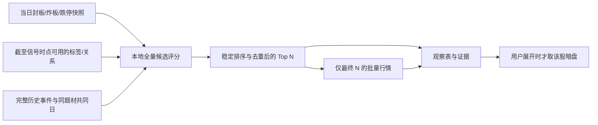

# ShadowFlow 功能审计报告

审计日期：2026-11-14，上海时区。代码与生产镜像均为 `dccf0e7e516e7ccdc86139fb11c1e139f7ee4735`。现场数据、日志和接口探针主要取自当天 10:09–10:24；后续验证为本地离线测试。

**结论：采集和研究页面已有可用基础，但现有收益标签不能直接用于量化训练。**本轮确认了未复权收益、缺档导致周期错位、行情备源成交量单位不一致，以及盘中分位的累计/区间口径混用。优先修复数据与收益定义，比更换模型或继续调整今日核心权重更重要。

本轮交付为审计、证据、改造方案和离线量化参考框架。生产仅执行有资源限制的只读查询和少量接口探针，未重跑全市场同步、重算生产标签、修改采集计划或部署代码。

## 一、对五个问题的直接回答

| 关注点 | 审计结论 | 建议 |
| --- | --- | --- |
| 日终五分钟、日 K 能否随时取 | **普通 K 线不局限于日终时段，但不能把五分钟当作无限历史。**本次周六上午直连可取日 K；东财 000001 日 K 最早到 1991-04-03，五分钟只返回 2026-09-24 起的 1,488 根。THS 直连样本可见约十个月分钟历史，但对更早日期会返回错误日期的单根数据 | 普通五分钟从“每日主归档必须完成”中拆开，先采用每 5 个交易日一次的滚动增量缓存；日 K 保留每日批量采集，成本很低。资金曲线另论，不能一起降频 |
| 长期缓存是否要考虑除权 | **必须。**保存未复权原始价格是正确的；直接拿它跨除权算收益是错误的 | 原始行情 + 公司行动 + 明确的复权算法/因子版本。收益标签和真实成交价格分层，不能每天拼接不同锚点的前复权价格 |
| 东财行业/概念成分现在成功吗 | 最近全量成功为 **11 月 11 日：1,027 板块、95,791 条关系**；12、13 日各失败 9 次。今天生产机的行业目录第一页和 BK0448 全部 94 个成员低频探针成功，说明当前局部恢复可达，**不等于全量同步已恢复** | 加独立关系质量卡、最近成功截面、失败明细和交易日滞后数；修正每日重试预算。不要将旧关系包装成当天已确认关系 |
| 成分能否追溯 | 本地有 **2026-08-14 基线 + 增删事件**，但中断期间只能知道两次成功观察之间发生过变化。另核实了 Tushare `dc_member` 官方文档：概念每日历史成分起于 **2024-12-20** | 优先考虑同体系历史快照补缺；“新增概念”新闻只能补充证据，不能重建完整历史成分。第三方接口权限及行业覆盖需另验 |
| 今日核心、股票联动和最小模型 | 共现研究有价值，但当前评分仍有语义、请求量和数据口径问题；低请求新方案尚未按文档完整接入当前代码 | 先完成“当日事件 + 本地证据决定排名，行情只补展示”，再做前向验证。最小训练先固定 t+1 开盘至 t+6 开盘的五日收益，先用八个简单特征建立基线 |

## 二、已核实的功能问题与优先级

P0 表示阻断训练真值的可信性；P1 表示会使功能结果失真或关键状态不可见；P2 表示需要明确覆盖和使用边界。这里不是安全漏洞评级。

| 编号 | 级别 | 问题与影响 | 证据 |
| --- | --- | --- | --- |
| F01 | P0 | `future-returns-v1` 直接用未复权收盘价相除，没有公司行动处理。送转导致的价格变化会被当成亏损 | `analytics.go:756`；隔离库 10→5 得到 -50%，即使经济上是一股变两股 |
| F02 | P0 | horizon 按完整归档日期计数，缺一天五分钟 K 就可能改变“未来 1 日”的目标；滚动特征也在完整归档日期间跳跃 | 生产 **2026-11-11 的 horizon=1 指向 11-13，共 5,026 条个股标签**，跳过已有日 K 的 11-12 |
| F03 | P0 | THS 五分钟成交量“股”和东财“手”混存，进而把 THS 推算的换手率放大约 100 倍；数量完整校验无法识别 | 11-13 浦发银行：日量 761,573，分钟量合计 76,157,313；日换手 0.23%，分钟换手合计 23.0002% |
| F04 | P1 | 今日核心“同一时点自身历史分位”将累计资金除以单个五分钟成交额，并将累计实时换手与单桶历史换手比较 | `candidate_history.go:76–97`；实际代码合成复现：应为 10% 的累计资金占比读成 480% |
| F05 | P1 | 成分同步失败没有进入质量页；关系 API 只回显查询 `as_of`，不提供最后成功截面；空变更列表无法区分“无变化”和“同步失败” | 生产 11-13 关系 API HTTP 200、28 条旧关系；变更 API HTTP 200、0 条，同时该日 9 次失败 |
| F06 | P1 | 低在线请求设计文档称已接入，但当前线上同版本代码仍扫描候选行情、读分钟历史并请求暗盘；报价失败仍能使整个候选接口 503 | `api/limitup.go:315`、`api/today_ranking.go:100`；文档/实现核对 |
| F07 | P1 | 主线先做时效/炸板折价，随后再除以当次最大值；只有一条主线时折价被归一化抵消。重复标签仍可能放大同一批封板成员的证据 | 实际函数复现：时效从 1 降到 0.3412、封板质量降到 0.8，最终主线权重仍是 1 |
| F08 | P1 | THS 解析先覆盖首根 open、末根 close 并扩大高低区间，再做日线一致性校验；“通过”不能证明原始首末价格一致 | 实际函数接受首开 9.7→10、末收 9.6→10.5 的无标记改写 |
| F09 | P1 | 关系的请求日期/发现日期不等于供应商历史生效日期；采集器接收任意日期，却仍调用实时成分接口 | `collector/relations.go:12`、`eastmoney/relations.go:318`；回补历史日期存在把今天关系写到过去的风险 |
| F10 | P2 | “历史累计标签”实际仍受查询窗口截断；只有历史涨停分类覆盖的股票才有标签，不能等同完整概念成员全集 | `sqlite/theme.go:49`、`api/limitup.go:229`；当前 243 个分类日期、默认最长约一年 |
| F11 | P2 | 当前归档 revision 在原 ID 上更新；现有未来最大有利/不利收益只扫描未来收盘价，不能当成盘中止盈止损可达值 | `revision.go:60–105`、`analytics.go:757–763` |

F01–F04 应作为量化接入前的硬门槛。F03 的线上样本不是小幅供应商误差，而是系统性的单位问题；F02 已发生在真实标签里，并非仅推演。

11 月 13 日归档中有 **4,931/5,026 只股票**标记为 THS 五分钟来源，因此 F03 应按批量数据契约问题处置。本轮逐股核对的是两个 THS 样本及东财对照，不把抽样描述成全库逐行复核。

### 已具备、应保留的能力

- 日终资金分批暂存、完整后原子发布；失败保留此前完整版本。
- 五分钟 K 以完整股日增量写入，重试可跳过已完成股票。
- 涨停/炸板/跌停事件与价格资金归档分离；完整空事件日和缺失日有区别。
- 事件分析排除研究截止日之后的记录，今日核心历史排除今天。
- 成分采用基线与增删记录，失败扫描不把旧关系删除成空表。
- 生产镜像与本地 revision 一致，容器健康、当前启动周期重启次数 0；本轮相关后端测试及前端 102 项测试通过。

这些是可靠性的基础，但不能替代字段语义、公司行动和收益标签验证。

## 三、日 K、五分钟数据的可取窗口与缓存方案

### 3.1 必须拆成四种数据

| 数据 | 当前路径 | 当前用途 | 能否作为同一生命周期管理 |
| --- | --- | --- | --- |
| 普通日 K | 日终主要由东财批量行情补入 `rank_snapshot.daily_close` | 价格、量额、日级特征和标签 | 应独立完整性；无须等待五分钟 K |
| 普通五分钟 K | 东财 `klt=5,fqt=0`；失败转 THS `min_5,actual` | 分钟行情研究 | 可单独按周滚动缓存，前提是修好契约和依赖 |
| 暗盘/主力五分钟资金点 | `darktradetick?time=0`，当前返回的一分钟累计曲线中选择 48 个时点 | 不可替代的专有资金历史 | 应每天优先留存；不是普通 K 线 |
| 日终资金榜 | `darktrade?date=...` | 排名、资金、股票/板块截面 | 有独立历史能力，不能据此推定资金曲线也可回取 |

截至此次版本，**新的五分钟归档已取消整天一分钟聚合备源**。当前链路为东财原生五分钟 → THS 原生五分钟；东财首桶修正路径仍可能读取一分钟数据。旧数据中的 `stock_trends_1m_241` 保留其历史来源。本次没有重新采集或删除旧聚合数据。

### 3.2 本次接口实测

全部是少量股票/日期样本。单次返回范围、单次长度、供应商长期留存承诺是三件不同的事。

| 探针 | 本次返回 | 可以确定什么 |
| --- | --- | --- |
| 东财 000001 日 K，`fqt=0`，1990 年至今 | 8,517 根，1991-04-03 至 2026-11-13 | 有多年日线历史，周六也可取；没有证据支持“只能当天日终取” |
| THS 000001 日 K，`actual` | 8,531 根，1991-04-03 至 2026-11-13 | 同样有多年日线；两家条数不同，不能直接宣称逐日契约完全一致 |
| 东财 000001 五分钟，`beg=20200101,lmt=10000` | 1,488 根，2026-09-24 至 2026-11-13，即 31 个完整交易日 | 本次可见窗口约 7 周自然时间；请求更大 lmt 没取得更多历史 |
| 东财同股 2025-11-14 精确日期 | HTTP 200、业务码 0，但 0 根 | HTTP 成功不代表该历史日可取 |
| THS 000001 五分钟，直连扩大请求 | 9,792 根，2026-01-09 至 11-13，204 个完整交易日 | 样本可见约十个月分钟历史；400 根不是总保留上限 |
| THS 000001/600000，直连请求 2025-11-14 | 分别返回 2026-01-09 / 01-14 的单根数据，目标日 0 根 | 过旧日期可能被钳到可见起点，必须拒绝日期不符的响应 |
| `darktrade` 行业榜第一页 | 11-13、11-12、11-06、11-05、08-14 均回显正确日期并有数据 | README“约 5 个交易日”的统一描述不能继续作为依据；未认证所有榜单/日期的完整历史 |
| `darktradetick?time=0`，000001 | 240 个 2026-11-13 的一分钟累计点，覆盖 09:31–15:00 | 当前实现只取得最新交易日资金曲线，再选 48 点；当前路径没有历史日期选择能力 |

**保留一项反证：**默认网络环境首次请求 THS 2025-11-14 返回过 400 根目标历史数据，但直连同参数、另一只股票和不同长度复测均未复现。没有把它删除，也没有将其当作“一年以上稳定可取”的依据。默认代理/连接路径和直连必须分别记录；目前不足以解释其原因。

THS 的 `begin_time=-1000/-2400` 返回了超过所请求数量的 9,792 根；它不是已经认证的严格数量上限。实际接入滚动缓存时应按日期检查完整性、限制响应字节、记录返回首末时间，不能假定请求 1,000 根就必然只返回 1,000 根。

“可随时取”的准确解释是：普通历史 K 线没有在本次观察中表现出固定的日终取数时段限制，且周末成功；它不意味着免费接口有 7×24 可用承诺，也不意味着所有股票保留同样久。单股样本不足以证明统一最早日期。

### 3.3 建议缓存周期

| 数据 | 建议的常规周期 | 缺口与修订策略 |
| --- | --- | --- |
| 暗盘资金曲线 | 每交易日盘后采集，当天完成 | 当晚有限重试。不要等到下个交易日再赌旧曲线仍在；当前历史参数能力未经认证 |
| 日资金榜 | 每交易日一次完整截面 | 日终榜可以历史校验，但曲线、行情日期和股票池仍分别验证 |
| 普通日 K | **每日批量增量**，另做每周小范围修订核对 | 以当前约五千只规模，每批 100 只约 51–54 次业务请求；不应改成逐股历史接口反而增加请求 |
| 普通五分钟 K | **每 5 个交易日一次**批量日期范围缓存 | 每股一次取多日，按股日校验并发布；初始重叠 1–2 日用于比较修订。超过 5 个交易日有未缓存缺口则提示，超过 10 日提升优先级 |
| 重点观察股票分钟数据 | 有实际分钟回放需求时每日或按需 | 这是额外服务层；全市场历史股票池仍应保留，不能只留事后入选股票 |
| 公司行动/复权因子 | 每日按市场批量增量，历史更正生成新版本 | 原始价格不随复权锚点重写；必要时重建受影响特征和标签 |
| 成分关系 | 至少每交易日一次完整观察 | 如果要称“日终成分”，应有盘后扫描；当前早晨 07:00 的结果只能称盘前观察 |

每 5 日一次是初始工程建议，不是东财公开保证。按本次东财 31 个交易日窗口留出明显余量，**暂不建议直接改成月度，更不建议停止缓存后需要时再补几年分钟数据**。如以后证明多源历史窗口、日历覆盖和修订语义稳定，可重新评估 10 个交易日或月度计划。

单看五分钟 K 请求，五天各约 5,000 次改成一次取五天，业务请求数约减少 80%；这不包含每日仍必要的资金曲线请求，因此不能说系统总请求量一定减少 80%。

### 3.4 不能只关掉 `stock-kline` 开关

现有 `SealArchiveRevision` 要求资金、日 K、五分钟 K 等整套完成。五分钟缺档会阻止整个日期进入 `daily_archive_current`，继而影响日级特征、标签和导出。11 月 12 日就是现成反例：5,028 只日 K 与资金已齐，但只完成 120 只五分钟 K，整日仍不完整。

正确改造顺序：

1. 按 `daily_price / minute_price / daily_funds / money_curve / relations / events / themes` 分别建立质量清单和版本。
2. 日收益标签只依赖相应价格、公司行动、日历及目标证券，不以“当天全市场五分钟是否全齐”决定目标日期。
3. 需要五分钟的特征只检查自己所用的股日和时间点；日级模型无需等待分钟完工。
4. 导出选择明确的“数据需求配置”，保留缺失掩码，不再以一个整日 complete 布尔量筛掉所有数据。
5. 分离后再调整五分钟周期，并确保清理任务仍保护尚未归档的不可重取资金数据。

当前日终日 K 来自带行情日期的实时批量快照；只把任务延后到很多天之后，不能靠这个实时接口补当时日 K。需要独立的历史日 K 适配器才能实施延迟回补。

## 四、长期行情与除权、标签的正确关系

### 4.1 缓存保留原始事实，计算层处理连续性

建议保留三层：

1. **原始行情层**：未复权 OHLC、成交量、成交金额、当日参考前收、供应商时间和来源。原始价格用于订单、涨跌停判定、实际成交与核对。
2. **公司行动/因子层**：公告与实施日期、每旧股现金、送转拆合股倍数、配股等类型，明确因子供应商、公式、锚点及版本。
3. **研究视图层**：连续价格、收益、波动率、均线、标签。计算时选定同一算法和冻结版本。

日 K 和分钟 K 都受跨日除权影响；同一个正常交易日内比价通常不需要跨日调整，但跨日窗口、隔夜收益、滚动均线和 ATR 都需要统一处理。分钟上应用因子时使用其所属交易日的因子；原始成交金额和暗盘/主力金额不直接乘价格复权因子。

不同供应商的“成交量”必须先统一单位。本次 THS 备源的 100 倍问题与除权是两个独立问题，不能通过复权修复它。

本次另核对了 000001 的 2025-03-24 日线：THS `actual` 开/收为 **11.41/11.38**，与东财 `fqt=0` 一致；THS `forward` 为 **10.203/10.173**。旧设计文档把这一组 actual/前复权示例数值写反了，应按本次原始响应更正。一个样本只能确认该样本的价格口径，仍需对其他证券与公司行动逐项认证。

### 4.2 不同收益不能混称一个 label

设上一交易日实际收盘 10 元、每股分红 1 元、除息参考价 9 元，后来价格 9.9 元：

| 计算 | 结果 | 含义 |
| --- | --- | --- |
| 9.9 / 10 − 1 | -1% | 未复权价格变化，遗漏现金权益 |
| 9.9 / 9 − 1 | +10% | 相对除息参考价的市场涨幅 |
| (9.9 + 1) / 10 − 1 | +9% | 现金分红不再投的持有财富收益 |

因此，简单将每日 `pct_chg` 连乘，虽然能排除许多机械除权跳空，仍不能未经定义就称作个人账户的总收益。Tushare 文档也区分未复权 close、除权后的 `pre_close`，并说明其复权行情采用分红再投。

如果使用标准乘法复权因子 A，已验证的同一体系下可以计算 `P_exit*A_exit/(P_entry*A_entry)-1`。同一快照的前复权锚因子在比值中会约掉；**并不是“使用当前复权数据必然造成收益标签泄漏”**。真正需要防止的是：混用不同日下载的锚点、跨供应商/算法拼接、直接使用非平稳绝对复权价作特征，以及把当时未知的公司行动/分类信息放进 X。

标签 y 本来就描述未来，可以用后来已确认的公司行动；特征 X 必须满足信号时点可用。标签版本应随真值更正更新，已训练模型对应的冻结数据包保留。

相对行业收益也要固定基准：行业身份按信号时点确定，明确比较的是含息总收益还是价格指数收益。不能在修好个股权益后，仍无说明地混用不同收益口径的行业基准。

### 4.3 现有数据应怎样处置

- 当前 `future-returns-v1` 保留用于追查，但应标为**不适合直接训练**；不要只改版本名字或对极端值统一截尾。
- 沿真实交易日历重建目标日期，再用公司行动或已认证因子重建收益。
- 除权识别可用“昨天实际 close 与今天参考前收不连续”作为排查线索，但不能把每个差值都判定为公司行动；还可能有源修订、精度或时段差异。
- 不是只删除除权当天那一行：凡持有区间跨过该公司行动的标签都可能受影响。入场就是除权日开盘时又应排除该日权益，边界需要测试。
- 对 THS 来源先修复单位契约，只对确认受影响的股日重算成交量相关字段及下游特征。不要全库统一除以 100；其他来源原本的单位不同。
- 原始首末价格被覆盖的数据应单独标识。不能从“校正后的结果”反推出当时真正返回的首末价格；必要时在可见历史窗口内重取并保留原响应。
- 股票池应有独立的历史证券状态。当前正常日终流程会排除无可用行情的记录，并重设 expected 总数；因此“5,026/5,026 完整”是当前研究股票池完整，不代表所有上市股票、停牌股和北交所都已被完整保留。

## 五、东财成分同步、日志与历史追溯

### 5.1 现场结果

| 日期 | 成功/失败运行 | 已发布关系 | 说明 |
| --- | --- | --- | --- |
| 11-09 | 成功 1 次 | 1,027 板块、96,284 条 | 当日完整扫描发布 |
| 11-10 | 成功 1 次 | 1,027 板块、95,679 条 | 当日完整扫描发布 |
| 11-11 | 成功 1 次 | 1,027 板块、95,791 条 | 最近一次成功，上海时间约 07:00–07:04:50 |
| 11-12 | 失败 9 次 | 无新版本 | 其中早期一轮曾推进到 79 板块、6,488 条；未完整发布，其后多次失败于目录第一页 |
| 11-13 | 失败 9 次 | 无新版本 | 目录第一页即失败，主/备域名均出现 EOF |
| 11-14 审计探针 | 2 次小范围成功 | 未执行新扫描 | 生产机返回行业目录 100/496、BK0448 成分 94/94 |

前面的初步进展将 12 日概括为第一页失败；更完整的运行记录显示，**12 日第一轮曾部分成功**。最终结论仍是该日没有新的完整关系版本。今天能取得一个板块，不能代替约一千个板块的全量发布验证。

这些证据与曾遇到出口/上游限制的体验相符，但 **EOF 本身不能证明唯一原因是封 IP，也无法推出准确封禁时长或安全 QPS**。今天的成功说明状态会变。不要用更多并发探针去“测封禁阈值”。

### 5.2 为什么看不到日志

日志存在于 `relation_sync_run`，调度记录在 `scheduled_job`。前端质量页“最近运行”读取的是普通 `CollectionRun[]`，没有关系同步卡片或列表；关系 API 的 `meta.as_of` 是请求日期，不是确认成功日期。

实测 `/stocks/000001/boards?as_of=2026-11-13` 返回 28 条关系，却未提供 `last_successful_sync_date=2026-11-11`。`/relations/changes?trade_date=2026-11-13` 返回空数组，同时没有“当日同步失败”状态。两者都容易让使用者误以为已经确认当天没有变化。

最小补齐方案：

```text
GET /relations/quality?trade_date=...
  requested_date
  status: disabled/not_collected/running/failed/complete
  last_successful_sync_date, last_success_at, stale_trading_days
  expected_boards, completed_boards, published_relation_count
  attempted_at, physical_http_attempts, last_error, current_stage
  observed_from, observed_to, snapshot_id
```

界面应并列显示“旧版仍可读取”和“当日同步失败”，而不是只用一个红/绿状态。变更接口只有在当日完成比较时才能声明“无变化”，否则是“未知”。运行过程应定期更新最后成功板块和请求统计；当前成功日志与最终失败结果不足以解释长任务卡在哪里。

当前 07:00、07:30、08:00 分别创建不同 job，每个可尝试 3 次，所以现场一天实际失败 9 次。建议改为**每交易日一个关系任务、多个唤醒时间共享一个总预算**；同时按主路径、备用域名和运输重试统一统计实际 HTTP 次数。

### 5.3 本地历史能回答与不能回答的内容

本地 baseline 起于 **2026-08-14**，后面记录 added/removed，可以重建“截至一次成功观察所知的成员关系”。但有三个边界：

1. 第一次基线之前无法凭当前表追溯。
2. 连续几日同步失败后再次发现新增，只能把新增时点限定在 `(上次成功观察, 本次成功观察]`，不能断言恰在本次扫描当天加入。
3. 目前采集接口没有供应商历史日期参数。将 CLI 日期设成旧日期仍会读取当前目录和成分，不能这样做历史回补；建议直接禁止这条路径的过去日期写入。

推荐把“供应商确认的有效日期”和“本系统第一次观察时间”分别保存；若有效日期未知，就保留区间。某个题材的一个历史涨停归因，也不能直接解释为此股票从那天起永久属于东财同名概念。

### 5.4 可追溯的外部来源

本次直接读取了 [Tushare DC 概念成分文档](https://tushare.pro/document/2?doc_id=363)：

- `dc_member` 支持概念代码、交易日和起止日期；历史起始 **2024-12-20**。
- 单次最多 5,000 条；不能一次请求后把截断结果当成全市场完整关系。
- 页面当前写明需要 6,000 积分权限。本轮只核实文档，没有使用用户 Token、购买权限或调用其受限数据。
- 示例代码 `BK1184.DC` 可映射到东财 BK 身份，但上线前仍需对相同日期做数量、代码、名称与覆盖核对。

它是补全**东财概念体系历史**的具体候选来源，优于用别家的主题名称强行替代。是否覆盖当前需要的所有行业层级、地域/风格板块，文档证据不足，不能将“概念接口有历史”扩大为“所有 1,027 个板块都已解决”。Choice 等商业终端可进一步询证，但本轮没有验证其具体产品权限和历史完整性。

“新增概念 XXX”的个股提示、新闻或核心题材说明可以用于人工核对加入原因及最迟可知时间，不能自动视为完整变更账本：通常缺少删除、改名、合并、静默调整，也可能是转载或另一家供应商的分类。只收集新增而不收集删除会使历史成员越积越多，并在回测中引入未来信息。

## 六、今日涨停核心与股票联动的深度审计和方案

### 6.1 先明确三个不同问题

| 视图 | 应回答的问题 | 目前证据能否支持 |
| --- | --- | --- |
| 股票联动/股性 | 过去哪些股票同日封板、触板、跌停；有哪些共同日期和行为特征 | 可以，基于独立事件归档；应保持为历史统计 |
| 今日主线与核心成员 | 此刻哪些方向封板集中、质量和新鲜度较高；哪些成员具有代表性 | 可以做规则观察，但网络中心性不等于先发动或真正带动 |
| 外溢候选/预测 | 哪些尚未封板股票值得优先观察，以及未来可执行收益如何 | 前者可规则排序，后者必须独立样本外验证；不能用共现次数直接宣称预测成功率 |

生产事件覆盖：默认范围 259 个完整事件日期（2025-10-22 至 2026-11-13）；扩展 ST/NEW 范围 254 日，最新只到 11-06。题材 payload 245 日，实际分类索引 243 日（2025-11-12 至 2026-11-13）。不同数据集的覆盖不能共用一个“历史一年齐全”的标识。

### 6.2 现有方案为何容易让结果看似精密、实则不稳

**一是在线行情进入评分，把网络可用性变成了策略输入。**当前依旧按候选上界分批读取行情与 SQLite 同分钟历史，粗筛后再取暗盘。默认结果 N=20 的首轮预取可以是 20+100+100+100 只，不是只查最终 20 只；后面还可能继续读取。失败切换供应商时，THS 当前快照没有换手率、量比和主力资金完整契约；换手却仍可能以默认 0 进入指标和风险项。页面报价恢复与否可能改变评分或使整个接口 503。

**二是自身分位的两边并不是同一种量。**实时换手是开盘累计，历史拿的是单个五分钟换手；历史资金是累计净流入，分母却是该桶成交额。必须先把历史量额累计到同一时点，或两边都转为区间增量；“同一分钟”不能自动保证语义一致。再叠加 THS 100 倍单位差，当前这些分位不能作为可靠确认信号。

**三是主线相对归一化抹掉绝对弱化。**实际代码将经过 freshness、seal_quality 折价的值，再除以本轮最大值。只有一条主线时，上午很强和下午已明显冷却都会被归一到 1。本轮已用真实函数复现。原先的时效公式本身不能弥补这一步。

**四是关系证据重复与题材语义混杂。**共同涨停网络中的边并不自动证明两只股票在那些共同日由同一个题材驱动；两只股票后来积累到同一标签，也不能补造过去“同题材共封”。同一批已封板股票挂多个相近标签，会在多主线组合里反复给同一候选加分。历史标签出现频次进入 `(o+r)/(o+r+2)`，也会间接奖励高频出现的股票。

**五是“累计归属”与“当前有效归属”尚未分开。**当前题材读取受 365 日窗口限制；同时，“一次因涨停进入某分类”只是一次历史归因，不是公司业务永久不变的证明。保留历史累计标签是有价值的，但最好同时显示“历史曾归因”和“最新确认关联”，不要静默当成一种事实。

### 6.3 推荐先完成低请求 v2，再做 v2.1 验证

现有 [低请求设计](docs/today-core-low-request-2026-11-12/design.md) 的方向正确，建议落实其主要边界，并修正文档“已接入”的状态。不要同时更换数据体系、增加模型、调整所有权重。



评分只读取当日三池和本地事实，行情失败不改变已有名次；暗盘不自动批量请求。现有三池有 15 秒缓存，v2 可先采用 30 秒共享缓存；同一时刻缓存未命中的并发调用仍需合并，不同 scope 的缓存也应各自保留。缓存键包含事件快照、历史/标签/关系版本和公式版本。

**方向强度**可以沿用已写出的固定区间方案作为第一条基线，不按本次最强方向再次归一化：

```text
n：当前封板数，至少 2
b：炸板且不在跌停池的数量；d：当前跌停数
e = S * m/U：在同一已识别股票全集内的自然覆盖期望

M = n/(n+3)
    * max(0,(n-e)/(n+e))
    * n/(n+0.5*b+d)
    * [exp(-Δt/90) + (1-exp(-Δt/90))*n/(n+5)]
```

U、m、S 必须来自同一市场范围和同一时间截面；标签覆盖不全时这是“已识别股票内集中度”，不能写成全市场显著性。对于历史未分类股票，缺标签是未知，不应当成确定不属于某主题。

**历史增强**使用窗口内可核实的同日、同明确题材、同封板事件。每条候选—成员边至少两个共同日，再对合格边的日期取并集 K：`H=K/(K+5)`。候选本身常涨停不单独加分，也不因为常涨停被 phi 惩罚；phi、lift 留在诊断栏。没有共同边但有明确归属的股票可以保留为“题材观察”，不得包装成“强历史跟随”。

**多标签去重**采用实际封板成员作为证据来源单位：

```text
E_theme = M * membership * (0.60 + 0.40*H)
q_theme = 1 - (1-E_theme)^(1/n_theme)
q_member = 该封板成员在候选命中方向中的最大 q_theme
score = 100 * (1 - product(1-q_member))
```

当前炸板候选的 0.8 折价可作为初始规则保留，并在后续消融中验证。乘积是有界排序组合，不是事件独立性的证明，也不是涨停概率。60/40、90 分钟、0.8 都是待验证参数，不以公式复杂度证明有效。

核心代表股单列其封板时间、连板位置、当日方向覆盖及历史关系；历史中心性不再反过来提高方向强度，避免“历史核心→主线→候选”重复强化同一份证据。

v2.1 再检验两项：一只很晚回封的成员是否会把整条旧主线全部刷新；历史累计标签是否过宽。可以比较“最近回封时间”和“成员各自时效的汇总”两个版本，但先固定一个基线，不在没有结果时连续加权。

### 6.4 股票联动怎样提升可信度

- 保留共同次数、共同日期、双向条件共现率、Jaccard、lift/phi 等原始解释；按共同次数找强关系和按特异性找罕见关系是不同需求，允许独立排序，不压成唯一神秘分数。
- 当前分母是已完整采集的市场事件日，未按两股共同上市、可交易和 scope 资格调整。用于频率解释时应给出这个限制；后续有证券状态表后再建立共同有效观察日 `N_AB`。
- 区分“同日同题材共封”和“历史标签相似”。前者需要该日分类记录；分类缺失不能补零或借今天成员关系回填。
- 小样本的 1/1、2/2 条件概率不应显示为可靠胜率；给观察次数、区间或贝叶斯收缩值，并保留未收缩原值。
- 多股票对/多题材筛选会产生偶然高相关。验证可按交易日和市场热度做置换/时间块 bootstrap，保留当日涨停池规模，不能随机打散所有股票行后当显著性检验。

真正的“带动”应额外研究：A 首次成为可观察信号时，B 尚未涨停；之后 5/15/30 分钟 B 的反应相对同题材、相近流动性对照是否更强。**目前日终三池的首次/最后触板时间不能完整还原每次盘中状态，也不能证明系统当时已知道那条分类。**现有资料适合共现研究，还不够验证日内因果或可交易收益。

建议先做 4–8 周前向观察：每天固定少量检查点保存三池快照、当时标签版本、候选及分数；例如 09:45、10:15、10:45、13:15、13:45、14:15。每个检查点复用共享快照，正常约为三池分页，不展开全市场行情。这里只是方案，未创建调度。日内反应指标与 A 股 T+1 可执行收益分别评估。

### 6.5 验收条件

1. 同事件/历史版本下，改变 Top N、是否成功补行情、供应商或是否读取暗盘，候选分数和相对顺序不变。
2. 排名过程自动暗盘请求为 0；普通行情只与最终 N 有关，物理 HTTP 次数包含主备及重试。
3. 相同封板成员重复贴标签不重复加分；新增不相关方向不改变既有候选分数。
4. 单一主线衰减、炸板增加时，其绝对强度确实下降。
5. 不存在用今天分类解释历史共同日、用事后数据还原当时可知信息的情况。
6. 前向结果与“只看主题归属”“只看共同次数”“当前线上评分”比较，报告候选稳定性、覆盖、耗时和后续收益，不只挑成功样例。

## 七、最小量化训练框架

完整说明、标签引擎、边界测试、固定配置及 LightGBM 脚手架见 [量化框架目录说明](docs/quant-minimal-2026-11-14/README.md)。核心选择如下：

| 模块 | 第一版决定 |
| --- | --- |
| 股票池 | 信号时点已上市且符合研究范围的历史股票池；保留退市/停牌事实，禁止用今日成分回填过去 |
| 信号/交易基准 | t 日盘后实际可用信息 → t+1 开盘 → t+6 开盘；固定五个交易日区间 |
| 标签 | 未复权价格 + 公司行动账本的税费前财富收益，现金不再投；缺失和暂不支持的行动不填 0 |
| 特征 | 先八个简单价格、波动、量额和换手特征；资金与题材在数据契约修好后分阶段加入 |
| 模型 | 小型 LightGBM 回归，固定初始参数；先与常数/简单规则基线比较 |
| 分割 | 按日期分组，训练/验证/测试顺序隔离；清除标签区间或可用时间越过边界的样本 |
| 检查 | 同一 dataset_id、标签版本、公司行动版本；每个 horizon 重新按外部日历验证；X 的 available_at 不晚于信号 |
| 评估 | Rank IC、误差与基线对比；组合收益交给独立执行模拟，不把报价收益当成交收益 |
| 再现 | 原始文件、日历、配置、代码、模型、预测及 SHA256 固定保存 |

默认事件档约一年，但当前生产只有 **33 个完整日级特征日期**。它们不能支持稳健的多年量化结论。建议先用可历史补全的普通日 K、证券历史和公司行动建立 2–3 年价格基线；资金特征没有同样长历史时单独做前向增量，不通过补零造出长样本。

标签核心测试会刻意验证：10 元每股派 1 元后变 9 元应为 0%；一股变两股、10 元变 5 元应为 0%；入场当天除权不享权益；退出当天除权享权益；缺失目标日不得顺延；`h=1` 不能变成当天买卖；未知行动不得当作无行动。

收益预测标签和真实账户 P&L 应分开保存。实际交易回测还需：整手约束、开盘量的参与率、滑点、当时有效的费用与税、涨停买不到、跌停卖不出、停牌和延迟退出、股利应收/到账、送转股实际可交易日期。遇到无法退出应保留持仓并反映风险，而不是删除失败样本或把下一次有价格那天偷偷写成原 horizon。

## 八、建议实施顺序

| 顺序 | 工作 | 可审核的完成条件 |
| --- | --- | --- |
| 1 | 隔离旧标签和有单位问题的分钟字段的训练用途 | 新数据导出明确标注 label/price/volume 契约；不能误读“complete=可直接训练” |
| 2 | 修正 THS 单位、累计/区间分位、无标记首末价格改写 | 跨供应商股日样本逐项一致；校正有原值、理由和版本，衍生特征重建范围明确 |
| 3 | 日 K、分钟、资金的完整性解耦；日历定义目标日期 | 11-12 分钟缺档时，11-11 的未来一日仍应是 11-12；缺价格才标缺失 |
| 4 | 关系质量、真实成功日期、日预算和历史回补防护 | 前端能看到 11-12/13 失败与 11-11 旧版；同步失败的变更状态是未知 |
| 5 | 将今日核心低请求 v2 真正接线，修正文档 | 行情故障不改名次、不阻塞本地排名；请求数符合最终 N 的预算 |
| 6 | 接入公司行动、冻结训练集，运行标签验收 | 至少一批真实分红/送转案例人工对账通过，再允许训练 |
| 7 | 日 K 基线训练，后续加入题材/资金并前向评估 | 固定测试集与执行规则，报告新增特征相对基线的增益和不确定性 |

五分钟降频安排在依赖解耦之后。仅为了减少请求而关掉它，会把更多日级数据卡在不完整归档，反而恶化现有标签问题。

## 九、验证记录与证据索引

| 验证 | 结果/边界 |
| --- | --- |
| 生产镜像/运行状态 | 与本地 `dccf0e7` 一致，健康；这只说明服务存活 |
| 生产元数据与关系 API | 有上限的只读查询；没有全库扫描、数据库备份、批量导出或生产重算 |
| 真实上游请求 | K 线、资金和关系的小样本低频请求；没有全市场压测、出口轮换或反复并发探测 |
| 后端相关测试 | limitup、SQLite、collector、eastmoney、thsquote、marketdata、scheduler、API 八个包通过 |
| 前端测试 | 102/102 通过；本轮没有重新做全部浏览器交互及移动端视觉验收 |
| 代码问题复现 | 四项 Go overlay 诊断通过，复现五类问题：原始收益/周期跳跃、累计口径混用、主线衰减抵消、首末价格改写；不修改产品源码 |
| 量化参考实现 | 22 个标签边界测试通过；合成数据完成实际 LightGBM 训练/预测/保存及五项流程检查，未以生产数据训练或声称预测收益 |

本轮的 PASS 表示测试执行符合其断言。诊断测试断言的是“问题确实存在”，不能解释成相应功能正确；原有测试全通过也不能反证实际数据口径问题。

本地证据：

- [运行元数据](docs/functional-audit-2026-11-14/runtime-metadata.json)
- [关系、标签和事件覆盖现场证据](docs/functional-audit-2026-11-14/runtime-functional-evidence.json)
- [生产机东财恢复探针](docs/functional-audit-2026-11-14/production-eastmoney-probe.json)
- [跨供应商成交量/换手率样本](docs/functional-audit-2026-11-14/volume-contract-evidence.json)
- [东财直连历史范围](docs/functional-audit-2026-11-14/eastmoney-retention-history-probes.json)
- [THS 直连边界与异常响应](docs/functional-audit-2026-11-14/ths-boundary-history-probes.json)
- [THS 扩展探针](docs/functional-audit-2026-11-14/ths-extended-history-probes.json)、[保留的默认网络路径反证](docs/functional-audit-2026-11-14/ths-history-probes.json)
- [资金接口窗口样本](docs/functional-audit-2026-11-14/funds-window-probes.json)
- [代码复现日志](docs/functional-audit-2026-11-14/code-reproductions.log)、[可复现入口](docs/functional-audit-2026-11-14/run_code_reproductions.py)
- [前端测试日志](docs/functional-audit-2026-11-14/frontend-tests.log)
- [验证汇总](docs/functional-audit-2026-11-14/validation-summary.json)、[训练流程验收](docs/quant-minimal-2026-11-14/training-verification.json)

关键代码定位：

- [旧标签与目标日期](/Users/roiding/Documents/ChatGPT/暗盘研究/backend/internal/repository/sqlite/analytics.go:730)
- [THS 分钟解析和首末校正](/Users/roiding/Documents/ChatGPT/暗盘研究/backend/internal/datasource/thsquote/client.go:435)
- [同分钟历史取值](/Users/roiding/Documents/ChatGPT/暗盘研究/backend/internal/repository/sqlite/candidate_history.go:76)
- [成分任务](/Users/roiding/Documents/ChatGPT/暗盘研究/backend/internal/collector/relations.go:12)
- [关系 API 元数据](/Users/roiding/Documents/ChatGPT/暗盘研究/backend/internal/api/server.go:284)
- [每日关系邀请及重试政策](/Users/roiding/Documents/ChatGPT/暗盘研究/backend/internal/scheduler/scheduler.go:191)
- [当前今日核心行情路径](/Users/roiding/Documents/ChatGPT/暗盘研究/backend/internal/api/today_ranking.go:100)
- [主线归一化](/Users/roiding/Documents/ChatGPT/暗盘研究/backend/internal/limitup/theme.go:259)

外部资料（本次已读取）：[DC 概念历史成分](https://tushare.pro/document/2?doc_id=363)、[未复权日线及参考前收](https://tushare.pro/document/2?doc_id=27)、[复权因子](https://tushare.pro/document/2?doc_id=28)、[复权算法与分红再投](https://tushare.pro/document/2?doc_id=146)。免费 Web 接口的保留时间和限流没有获得供应商承诺；上表数值是带日期、证券、网络路径的实测观察。
